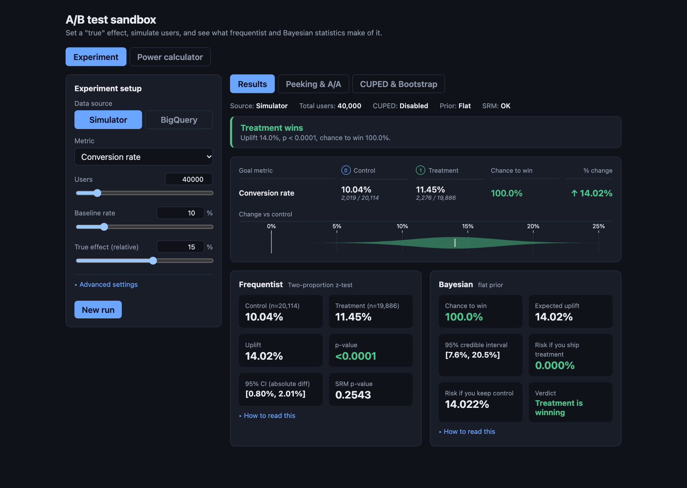
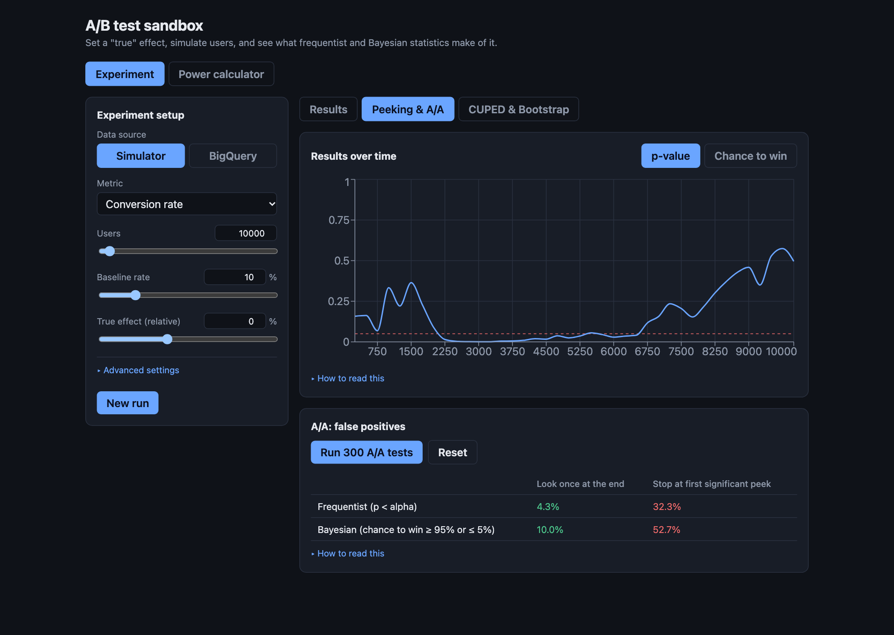
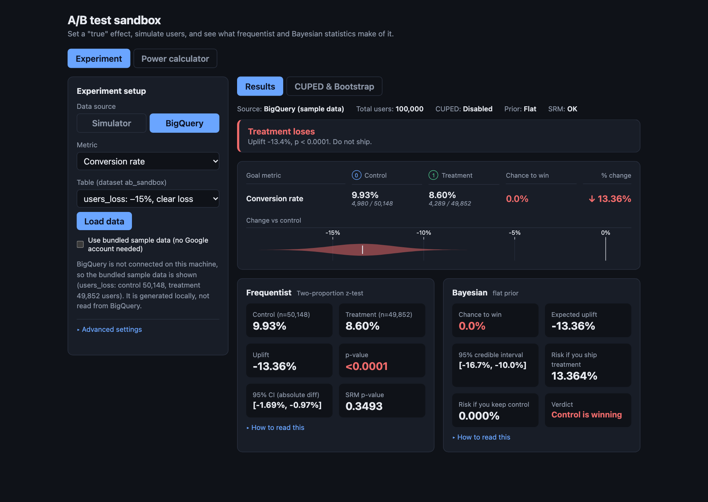

<div align="center">

# A/B test sandbox

**Set the truth. Simulate the users. See when an A/B test finds it, and when it lies.**

A small lab where you can play with the statistics behind A/B tests: frequentist and Bayesian analysis, power, peeking, SRM and CUPED. The main idea is simple: you already know the right answer, so you can check if the test got it right.



React 19 · TypeScript · Vite · Recharts · Vitest · BigQuery

<sub>Work in progress. It isn't deployed yet, so for now you need to run it locally. It's just two commands, see [Quick start](#quick-start).</sub>

</div>

## Why it exists

In a real experiment you never know the truth. So when a test says "we won", it's hard to tell if the result is real or you were just lucky. In this project **you choose the effect yourself**, and you can run the experiment again and again. Well, this makes the usual traps easy to see:

- **Same truth, different answers.** Even with a real −15% effect, the test finds it in only about half of the runs when you have 5,000 users.
- **False wins.** If there is no effect at all, about 5% of tests still "win". And if you stop at the first significant peek, it's like 30%. Being Bayesian doesn't help here (about 50%).
- **Missing a real effect.** The effect exists, but the sample is too small, so the test just doesn't see it.
- **Silent problems.** With a sample ratio mismatch (SRM) the test can be completely broken, and the numbers still look fine.

## See it

<p align="center">
  <br>
  <sub><b>Peeking &amp; A/A.</b> There is no real effect, but the p-value still goes below alpha at some point. In 300 A/A tests it's 4% false wins if you look only once, and 32% if you stop early.</sub>
</p>

<p align="center">
  <br>
  <sub><b>BigQuery view.</b> The same analysis, but on a table. Here it's a clear loss: the violin is red and the verdict says not to ship.</sub>
</p>

## What's inside

| Area | What it does |
|---|---|
| **Simulator** | Users are split into groups with a hash. Metrics: conversion, click and revenue (with heavy-tailed order values). You can break the split on purpose to see SRM. Up to 300,000 users, and results are reproducible with a seed |
| **Analysis** | z-test, Welch's t-test, a Bayesian engine like in GrowthBook (chance to win, risk, credible interval, optional prior), CUPED and bootstrap |
| **Peeking and A/A** | p-value and chance to win over time, plus 300 A/A runs that compare "look once" with "stop at the first win" |
| **Power calculator** | Sample size, test duration and a power curve, for proportions and for means |
| **BigQuery view** | The same analysis on a real table. If BigQuery is not connected, it uses the sample data that comes with the project, so you don't need a Google account |

## Quick start

You need **Node 22** (`nvm use` reads `.nvmrc`) and Yarn.

```bash
yarn install
yarn dev          # http://localhost:3002, simulator and BigQuery sample data
```

If you are new to A/B statistics, [`GUIDE.md`](GUIDE.md) explains every control and number, and there are some exercises too.

## BigQuery (optional)

The BigQuery view works out of the box. When there is no connection, it uses the sample data automatically ([`src/bq/demo-summaries.json`](src/bq/demo-summaries.json), you can regenerate it with `yarn demo-data`), and the UI tells you about it.

If you want to use your own project, run [`docs/bigquery/setup.sql`](docs/bigquery/setup.sql) in the BigQuery console (it makes four dummy tables: win +15%, loss −15%, A/A 0% and small +3%). Then run `gcloud auth application-default login`, and after that `yarn start`. Your credentials stay in `~/.config/gcloud`, so they never go to the repo or to the browser. More details are in [`GUIDE.md`](GUIDE.md#5-the-bigquery-source).

## How it works

```
simulated users or a BigQuery table  →  per-group summary  →  statistics  →  verdict
                                        (n, mean, variance)
```

BigQuery does the heavy work with one `GROUP BY variant` query, so the browser gets only two rows. The statistics code works on this summary, so the simulator and BigQuery use exactly the same code.

| Method | Idea | Source |
|---|---|---|
| z-test, Welch's t-test | Classic tests for proportions and means | Textbook; Welch, 1947 |
| Bayesian | Gaussian posterior of the relative lift (delta method), chance to win and expected loss | GrowthBook's approach |
| CUPED | Remove the part of the metric that can be predicted from the behaviour before the test | Deng, Xu, Kohavi, Walker, 2013 |
| Bootstrap | Resample each group many times and take the percentile interval | Efron, 1979 |
| SRM | Chi-square test: observed split vs planned split | Standard A/B practice |

## Engineering notes

- **No statistics libraries.** Everything is written in TypeScript and tested against known values (47 tests with Vitest). One test checks that CUPED from SQL aggregates gives the same result as CUPED from raw rows, up to 8 decimals.
- **It found its own bug.** At some point the SRM check started to show strange alerts. After a closer look, a bias was found in the bucketing (plain FNV-1a on sequential ids). It was fixed with a murmur3 finalizer, and a regression test was added.
- **It stays fast.** Simulating 300,000 users takes about 150 ms. A/A runs and bootstrap work in small batches, so the page doesn't freeze.
- **Credentials don't reach the browser.** There is a tiny local API that returns only aggregates, and table names are checked before they go into SQL.

## Project structure

```
src/
  stats/        z-test, Welch, Bayesian, CUPED, bootstrap, power
  sim/          seeded RNG, bucketing, user simulation, A/A runner
  bq/           BigQuery client, bundled sample data
  components/   Experiment and Power tabs, result row, panels
server/         local BigQuery API (aggregates only), SQL builder
docs/bigquery/  setup.sql for the dummy tables
GUIDE.md        walkthrough of every control and number
```

| Command | Purpose |
|---|---|
| `yarn dev` / `yarn start` | UI only / UI plus the BigQuery API |
| `yarn test` | Vitest: statistics, simulator, SQL builder, rendering |
| `yarn lint` / `yarn build` | ESLint / type-check and production build |
| `yarn demo-data` | Regenerate the bundled sample data |

## Limitations and ideas

- Every user gets the same effect: no segments, no seasonality, and only one metric at a time.
- The Bayesian engine is Gaussian (like GrowthBook), so it is less accurate when you have only a few dozen users.
- BigQuery mode has no time dimension, so peeking, A/A and bootstrap work only in the simulator.
- Next steps, maybe: sequential testing, multiple-comparison corrections, a "% change over time" chart and a GA4 export as a data source.
